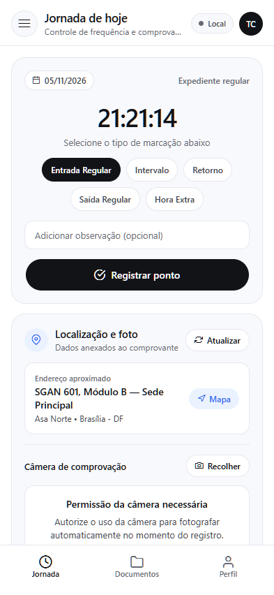
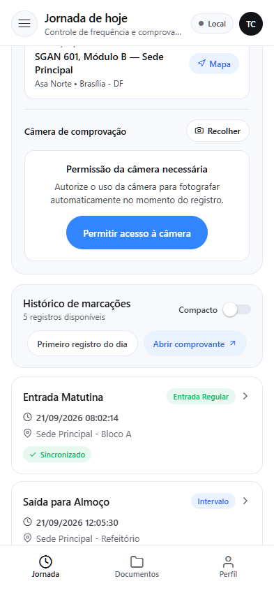
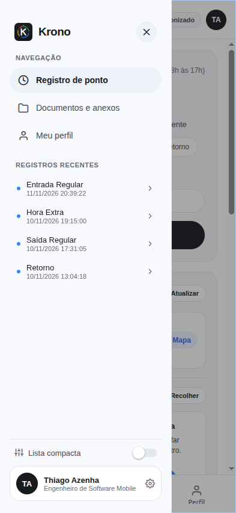
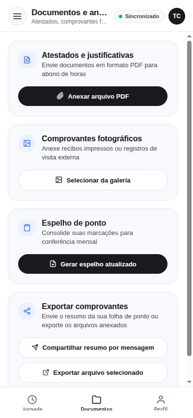
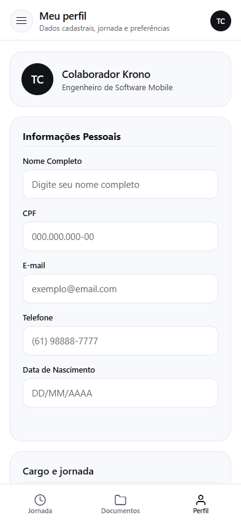
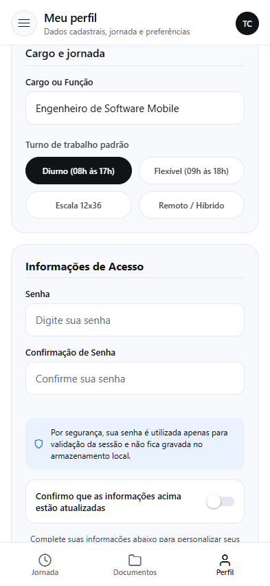
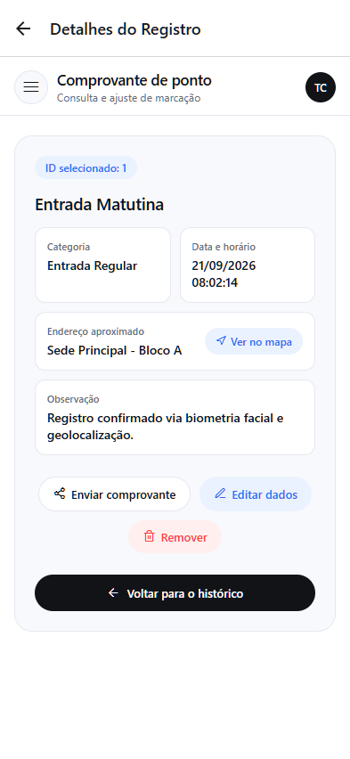

# Krono: Gestão de Jornada e Frequência (`v2.2.3` • Expo SDK 58)

Aplicativo multiplataforma (Android, iOS e Web Responsiva) em **React Native (Expo SDK 58 + Expo Router)** acompanhado de servidor **Node.js + Express**.


---

## Sistema Visual e Navegação Adaptativa

Tokens de design aplicados em `constants/theme.ts`, `components/AppShell.tsx` e `components/AntigravityHeader.tsx`:

| Token | Valor | Aplicação no App |
| :--- | :--- | :--- |
| **Obsidian Ink** | `#121317` | Tipografia principal, botões primários em formato pílula e barra de status |
| **Pure Canvas** | `#FFFFFF` | Plano de fundo limpo de alto contraste |
| **Bento Surface** | `#F8F9FC` | Superfície dos cartões modulares (`borderRadius: 20px`) |
| **Pill Surface** | `#EEF1F8` | Botões secundários, seletores de turno e badges informativos (`borderRadius: 9999px`) |
| **Spectrum Accents** | `#3186FF` / `#00B95C` / `#FC413D` / `#FBBC04` | Indicadores de status (Entrada, Saída, Hora Extra e Sincronização com Servidor) |

### Layout Responsivo (`components/AppShell.tsx`)
- **Android e iOS (`width < 960px`)**: Menu lateral deslizante acionado pelo topo da tela, com atalhos para as seções principais, lista de marcações recentes para acesso rápido aos comprovantes, controle de densidade visual (`Lista compacta`) e resumo do colaborador.
- **Web e Telas Grandes (`width >= 960px`)**: Barra lateral fixa à esquerda e área de conteúdo centralizada (`maxWidth: 1080px`) distribuída em grade de duas colunas.

---

## Registros Visuais da Aplicação (Interface Mobile)

As capturas abaixo ilustram o fluxo completo de registro, consulta, auditoria e gestão:

### Fluxo Operacional de Registro de Ponto

| 01. Jornada Principal | 02. Histórico de Ponto | 03. Menu Lateral Deslizante |
| :---: | :---: | :---: |
|  |  |  |
| Relógio em tempo real, seleção de tipo de ponto e geolocalização com mapa | Histórico com badges de sincronização e alternância de densidade compacta | Menu gaveta estilo Gemini com registros recentes e atalhos rápidos |

### Gestão Documental, Perfil e Comprovantes

| 04. Anexos e Documentos | 05. Dados Cadastrais | 06. Grade de Turnos 2x2 | 07. Comprovante Digital |
| :---: | :---: | :---: | :---: |
|  |  |  |  |
| Atestados em PDF, fotos e geração de espelho mensal | Dados do colaborador com máscaras dinâmicas de validação | Seletor simétrico de turnos com persistência em AsyncStorage | Rota dinâmica com geocodificação reversa e compartilhamento |

---

## Arquitetura Modular de Pastas 

```text
registroDePonto/
├── api/                          # Servidor Backend Node.js + Express 
│   ├── package.json
│   ├── README.md
│   └── server.js                 # Rotas /clima, CRUD /pontos, CRUD /filmes e POST /upload
├── app/                          # Rotas do Expo Router (File-based routing)
│   ├── (tabs)/
│   │   ├── _layout.tsx           # Navegação em 3 abas principais (Jornada, Documentos, Meu Perfil)
│   │   ├── index.tsx             # Aba 1: Relógio em tempo real, Câmera, GPS com endereço aproximado e Histórico
│   │   ├── cadastro.tsx          # Aba 2: Perfil do Colaborador, grade 2x2 de turnos e persistência AsyncStorage
│   │   └── explore.tsx           # Aba 3: Central de Documentos, Share, ImagePicker, PDF e FileSystem
│   ├── detalhes/
│   │   └── [id].tsx              # Rota dinâmica de comprovante com leitura por ID, edição (PUT), exclusão (DELETE) e Share
│   └── _layout.tsx
├── components/                   # Componentes de UI reutilizáveis e desacoplados
│   ├── AppShell.tsx              # Shell adaptativo (menu lateral mobile + barra lateral fixa Web)
│   ├── AntigravityHeader.tsx     # Cabeçalho com indicador de conectividade
│   ├── BotaoPress.tsx            # Botão pílula com animação de mola (Animated.spring)
│   ├── RegistroCard.tsx          # Card otimizado com React.memo e badges semânticos
│   └── cadastro/                 # Inputs com máscara, PickerModal e Checkbox
├── constants/
│   ├── pontosMock.ts             # 5 registros iniciais padronizados 
│   └── theme.ts                  # Paleta AntigravityPalette, Radii e fontes
├── models/
│   └── ponto.ts                  # Contratos TypeScript (PontoRegistro, PerfilColaborador, AnexoDocumento)
├── services/                     # Camada de serviços isolada da interface 
│   ├── apiService.ts             # Cliente HTTP fetch() para GET, POST, PUT, DELETE e FormData
│   └── storageService.ts         # Persistência local com AsyncStorage e serialização JSON
├── CHANGELOG.md                  # Histórico completo do Versionamento Semântico (v1.0.0 a v2.2.3)
└── README.md
```

---

## Como Executar o Projeto Completo

### 1. Iniciar a API Local Node.js + Express (Opcional: Modo Online)

Em um terminal separado, inicie o servidor na porta `3000`:

```bash
cd api
npm install
npm start
```

> **Nota sobre Operação Híbrida (Online e Offline):** O aplicativo possui fallback automático para o `AsyncStorage`. Caso o servidor Express não esteja em execução, o app continua operando localmente e sincroniza quando o servidor estiver disponível.

### 2. Iniciar o Aplicativo Expo (SDK 58)

Na raiz do projeto `registroDePonto`:

```bash
npm install
npx expo start
```

- Pressione **`w`** para abrir no navegador Web.
- Pressione **`a`** para abrir no emulador Android ou escaneie o QR Code no aplicativo **Expo Go (SDK 58)**.

---
